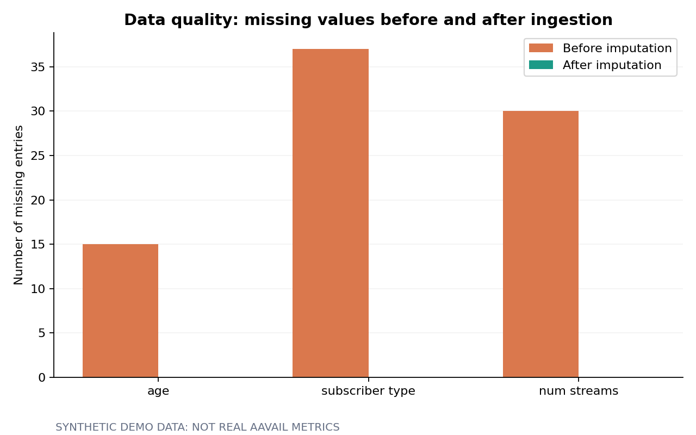
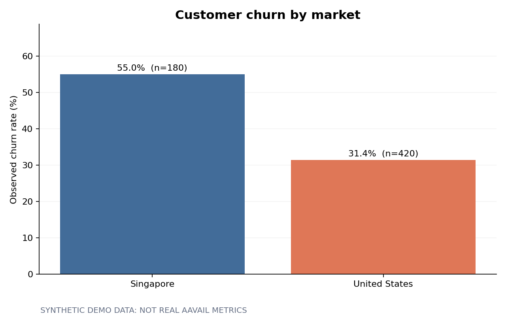
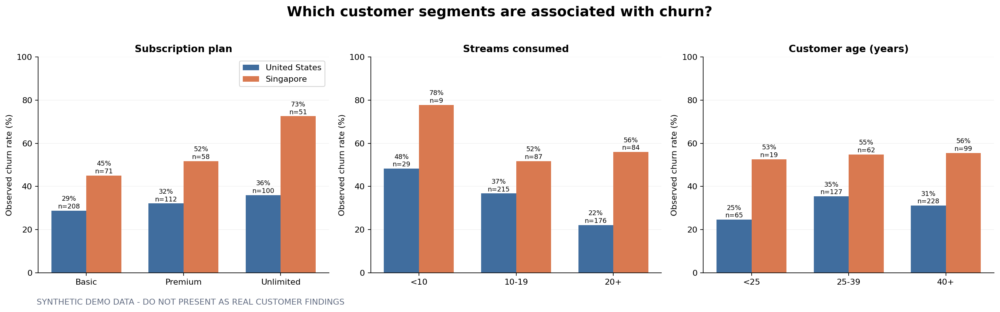
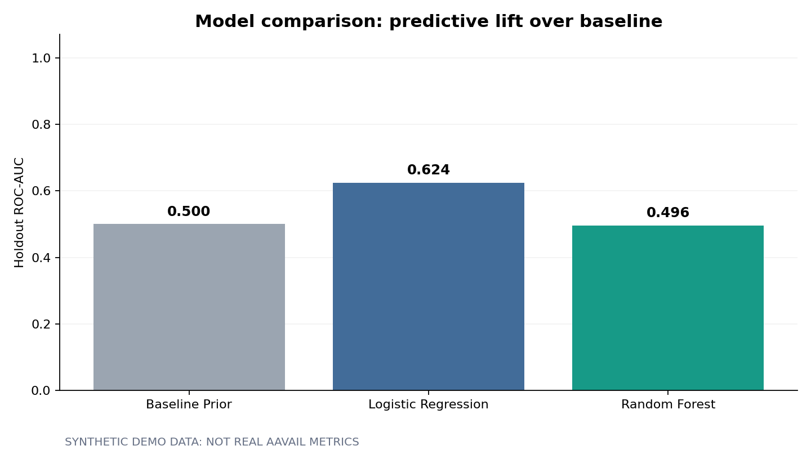

# Exploratory Data Analysis and Model Evidence

> **DEMO EXAMPLE ONLY.** This page shows the reporting pipeline using generated synthetic records. This evidence verifies the workflow and figure generation, **not actual churn performance in Singapore**. For business conclusions, retrain with the officially provided `aavail-target.csv` and regenerate the figures.

## 1. Source, definition, and ingestion

The synthetic demonstration contains 600 customer records (180 Singapore, 420 US). For authentic AAVAIL analysis, the notebook / instructor-supplied records must replace this fixture. The outcome is `churn = 1 - is_subscriber` with `is_subscriber ∈ {0,1}`. Customer names and identifiers are excluded from the feature matrix.

- 37 missing subscriber types and 30 missing stream counts were identified in the demo CSV.
- 15 implausible negative ages were treated as missing.
- Missing values were replaced with **within-country** modes (plans) and medians (numeric features).
- The sample report records zero columns dropped during ingestion, two columns excluded from modeling (`customer_id`, `customer_name`), and zero missing predictor values after imputation.
- `models/ingestion_audit.json` is generated during training with the full audit trail, including dropped rows and duplicate IDs.

**Figure 1.** Data quality review contrasts missing entries before and after the ingestion-level imputation. Review counts with the JSON audit rather than inferring them from plotted bar height alone.

## 2. Market context

**Figure 2.** Observed churn rate by market. The percentage depends on the data source and is not a causal attribution. A market with higher observed churn deserves deeper plan-level and usage-level inspection.

## 3. Investigation of potentially associated factors

**Figure 3.** Subscription type, streaming engagement and age-bucket rates provide a structured investigation of risk differences. An apparent difference may be confounded by other variables. Feature-level associations are hypotheses to test, not proof of why Singapore churns.

## 4. Predictive evidence versus baseline

**Figure 4.** Holdout ROC-AUC across a prior-probability baseline, logistic regression and a random forest. The champion is chosen among the non-baseline candidates based on ROC-AUC (F1 is a tie-breaker). Real-world evaluation should additionally include time-aware tests, performance by country, and calibration.

## 5. Proposed next steps

1. Train on the authorized, real AAVAIL export and replace the demonstration figures.
2. Check the model's class balance, country-stratified precision and recall, and probability calibration.
3. Investigate possible plan-value and engagement differences in Singapore using customer-level surveys and cohort analysis.
4. Instrument label feedback to measure precision, recall and ROC-AUC over time; monitor drift.
5. Validate a retention intervention by randomized controlled experiment rather than treating an EDA correlation as a causal finding.
